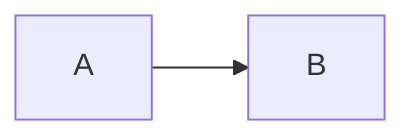

# Zenn 記法の要点

公式: https://zenn.dev/zenn/articles/markdown-guide ／ https://zenn.dev/zenn/articles/zenn-cli-guide

## ファイルと frontmatter

```
articles/<slug>.md        slug は a-z 0-9 - _ の 12〜50 文字。公開後の URL になる
images/<slug>/xx.png      本文からは /images/<slug>/xx.png（先頭スラッシュ必須）。1 枚 3MB まで
```

```yaml
---
title: "記事のタイトル"        # 必須
emoji: "📝"                    # 1 文字
type: "tech"                   # tech か idea
topics: ["rails", "openapi"]   # 最大 5 つ。小文字英数字
published: false               # AI は true にしない（hook で止まる）
published_at: 2026-11-01 09:00 # 任意。予約公開
---
```

## 本文でよく使うもの

````markdown
## 見出しは h2 から（h1 はタイトルと重複する）

```ts:src/index.ts
// ファイル名つきコードブロック
```

```diff ts:src/index.ts
- const a = 1;
+ const a = 2;
```


*キャプション（画像の直下に斜体）*

:::message
補足。読者が見落とすと困ること
:::

:::message alert
注意。壊れる・消える・課金される
:::

:::details 長い出力はたたむ
```
...
```
:::

@[card](https://example.com/)        # リンクカード
@[youtube](VIDEO_ID)



脚注[^1]
[^1]: 脚注の本文
````

## この skill での決め

- 画像は `NN-短い名前.png`（NN は登場順の 2 桁）。差し替えても番号は変えない
- コマンド出力は画像にせず、コードブロックに実行結果をそのまま貼る（コピーできる・検索できる）。定型は ` ```bash ` で 1 行目に `$ <実行したコマンド>`、2 行目以降に出力。キャプションは付けない
- 画像の alt は「何の画面か」を書く。斜体キャプションは著者が付けたいと言ったときだけ
- 長い出力は `:::details` にたたむ。本文には要る行だけ残す
- 1 節に図・コード・出力のどれかを最低 1 つ。地の文は 3〜6 文を目安
- リンクは原典（公式ドキュメント・論文・リポジトリ）を優先し、解説記事は「分かりやすい」と添えて並べる
- 画像は「説明の文 → 画像 → `<br>`」の順。Markdown の空行は詰められるので、余白は `<br>` で取る（Zenn で通る）
- 用語の説明は `:::message` ではなく 2 列の表（用語／意味）。`:::message` は注意アイコンが付き、警告に見える
- 英文の引用は `:::details 公式ドキュメントの原文` に、英文＋（訳）＋出典リンクで。本文は日本語の要点＋リンク
- mermaid は Zenn が iframe で描く（1 ブロック 2000 字まで）。クリックで拡大はできないので、縦線 4 本までにして文字を大きく保つ。強調の帯は `rect rgba(220, 53, 53, 0.4)`（ダーク背景でも見える）
- タイトルは 70 字以内（プレビューが警告を出す）
